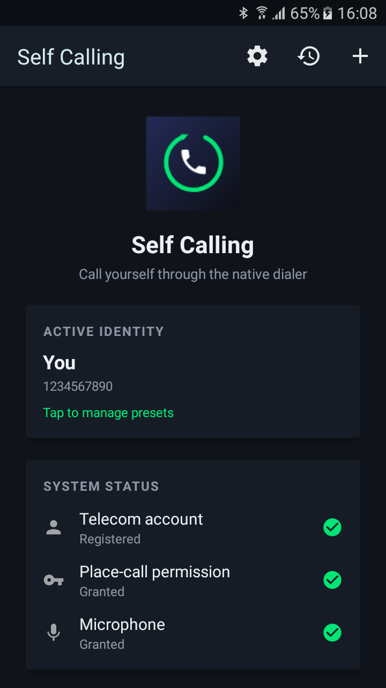
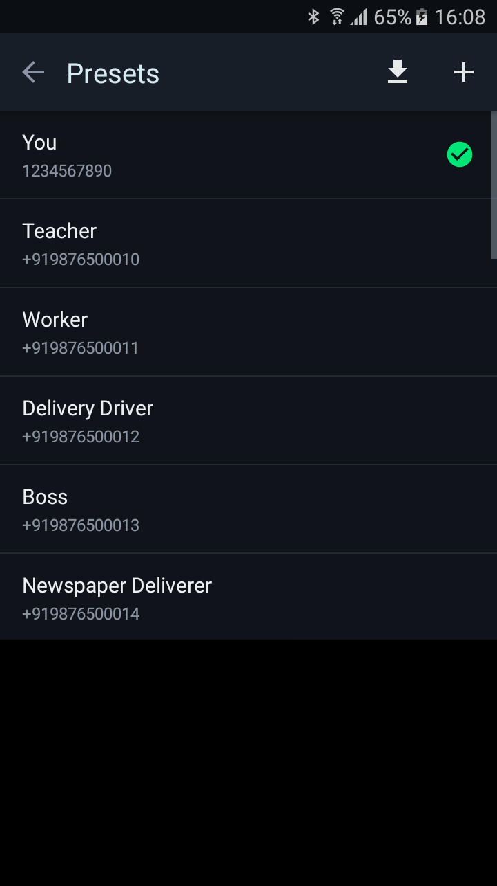
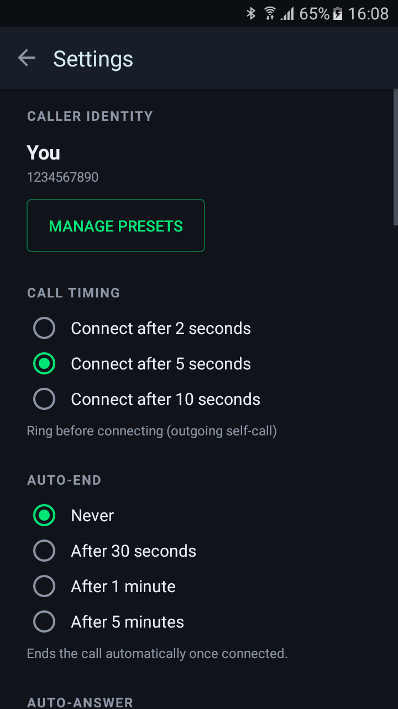
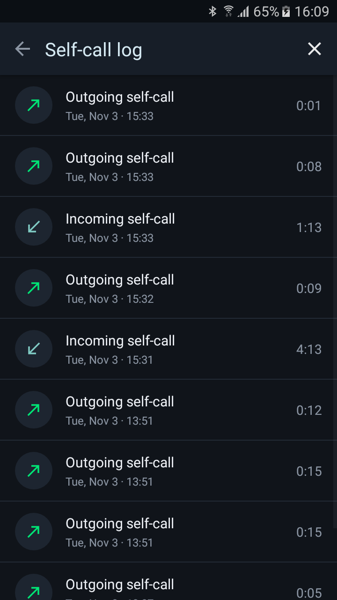
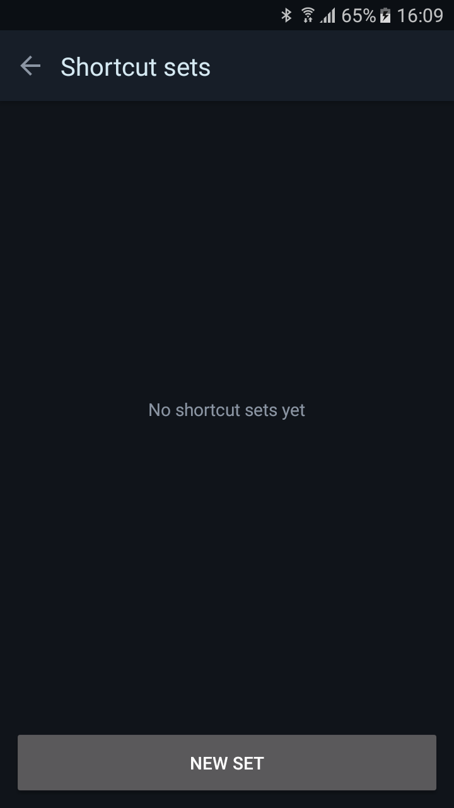

# New app: Self Calling

## Abstract for new app inclusion

### Please introduce the functions and usage of your app in summary, and also attach some screenshots.

Self Calling places simulated incoming calls and outgoing self-calls through the system Telecom stack, so they render in the native dialer UI exactly like a real call. The app only places calls; it does not route them through a SIM.

Usage:

1. Open the app. The home screen shows Telecom registration and permission status.
2. Tap **Call Myself** to place an outgoing self-call, or **Simulate incoming call** to receive one. The call appears in the system dialer / call UI.
3. Optionally configure a caller identity preset (name + number), the wait before an incoming call rings, auto-answer, auto-end, and the voice heard during the call.
4. **Shortcut Sets** build ordered chains of simulated calls, SMS messages and outgoing calls; home screen widgets run a set with one tap.
5. **SMS Auto-Reply** replies to incoming SMS automatically, globally or per contact, with optional keyword triggers.

Screenshots (also in the upstream repo under `fastlane/metadata/android/en-US/images/phoneScreenshots/`):

| Home | Presets | Settings |
| --- | --- | --- |
|  |  |  |

| Call log | Shortcut sets |
| --- | --- |
|  |  |

### Please elaborate why you wrote this app. Please highlight the unique functions it provides over other similar apps in F-Droid.

I needed to test dialer and call-flow behaviour on devices without touching a real SIM, and to reproduce repetitive multi-contact "simulated incoming call" sequences. F-Droid has call utilities, but I could not find one that:

- places calls through the real Telecom framework so the stock dialer shows a genuine incoming screen, rather than an in-app fake overlay;
- chains several calls, SMS messages and outgoing calls into a single Shortcut Set, run from a home screen widget;
- pairs this with SMS auto-reply and a caller identity (name, number, voice, video) configurable per preset.

The app is fully offline: no network permission, no ads, no trackers.

## Checklist

### Policy

* [x] The app complies with the [inclusion policy](https://f-droid.org/docs/Inclusion_Policy). _Pay special attention to Quality point 6._
* [x] The original app author has been notified (and does not oppose the inclusion). If you are not the author, please paste the link of the reply from the author. — I am the author, submitting my own app.
* [x] The upstream app source code repo contains the app metadata in a [Fastlane](https://gitlab.com/snippets/1895688) or [Triple-T](https://gitlab.com/snippets/1901490) folder structure. The summary and description must be included and images, icon, and changelog should also be provided for better user experience. The `en-US` locale must be included. — `fastlane/metadata/android/en-US/` with title, short and full description, icon, 5 phone screenshots and `changelogs/5.txt`.

### Docs

* [x] Please read [the guide](https://gitlab.com/fdroid/fdroiddata/-/blob/master/CONTRIBUTING.md) first if this is your first contribution.
* [x] Please make sure your metadata follows the best practice in [our templates](https://gitlab.com/fdroid/fdroiddata/tree/master/templates).
* [x] Please read the [Build Metadata Reference](https://f-droid.org/docs/Build_Metadata_Reference/) and make sure your metadata is valid.
* [x] Please read the [Quick Start Guide](https://f-droid.org/en/docs/Submitting_to_F-Droid_Quick_Start_Guide/).

### Merge Request Setup

* [x] The title of this merge request should follow "New app: app name" format.
* [x] Please make sure your fdroiddata fork is public and your branch is not protected.
* [x] Please read [our Git guide](https://gitlab.com/fdroid/wiki/-/wikis/Tips-for-fdroiddata-contributors/Git-Usage) if you don't know how to rebase your branch. Don't rebase your branch if there is no conflict.
* [x] All related [fdroiddata](https://gitlab.com/fdroid/fdroiddata/issues) and [RFP issues](https://gitlab.com/fdroid/rfp/issues) have been referenced in this merge request
* [x] Please only submit one app in one MR.

### Metadata

* [x] Metadata must be put in `metadata/<applicationId>.yml`.
* [x] Metadata must be a valid YAML file.
* [x] Metadata must use LF as line ending.
* [x] Don't add summary/description/changelog/images or anything that should be provided in upstream repo. Please check the Changes tab to make sure there is no other unrelated files added in the MR.
* [x] Releases are tagged and auto update is enabled unless there is a special reason.
* [x] There is an issue tracker and contact info of the author so that we can report bugs and contact the author.
* [x] An AuthorName must be added. It doesn't need to be the real name.
* [x] External repos are added as git submodules instead of srclibs.
* [ ] Enable [Reproducible Builds](https://f-droid.org/docs/Reproducible_Builds). — Not enabled for this first build. Please sign with the F-Droid key for now.
* [x] Setup abi split if the APK is large and the splitted ones can be much smaller. — The APK is ~1.2 MB with no native libraries, so ABI splits would not help.
* [x] Only the latest versions should be kept in the metadata before it's merged.
* [x] Don't add any disabled versions in the metadata.
* [x] The `commit` field should be the full hash.

### Pipeline

* [ ] All pipelines should pass.
* [ ] All warnings and errors in the Reports tab should be fixed or explained.
* [x] F-Droid CI runners are under GitLab's FOSS program.

---------------------

Closes rfp#<RFP issue number>

/label ~"New App"
